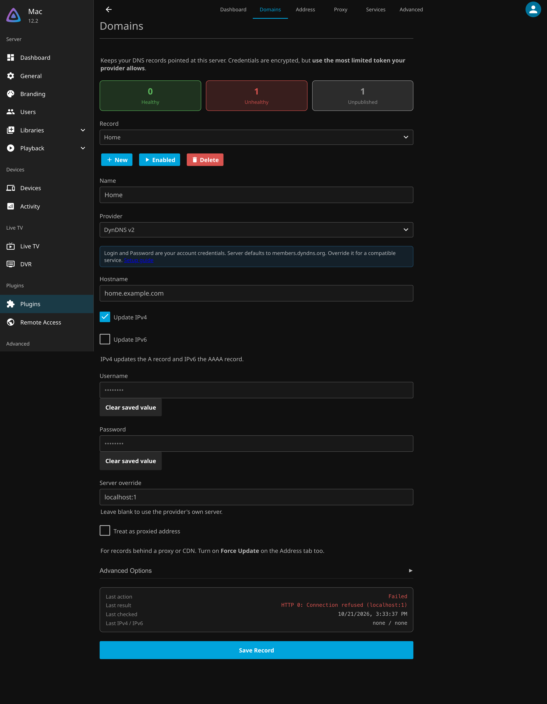

# The Plugin's Pages

Remote Access adds one entry to Jellyfin's dashboard menu, under **Plugins → Remote Access**. Its pages share a
tab bar along the top: **Dashboard**, **Domains**, **Address**, **Proxy**, **Services** and **Advanced**.

## Dashboard

Who reaches the server, from where, and what was turned away.

* **Locations**: a world map and a table by country. **Users**, **Failures** and **Blocked** pick what the map
  shows, one or more at once. All three are on when the page opens.
* **Banned**: addresses banned for failed sign-ins, with **Unban** on each.
* **Activity**: every recorded visit, sign-in, failure and refusal, filtered by type and country. A row can be
  blocked or unblocked from here.

History is kept for the days set under **Advanced → History**. Locations come from the
[DB-IP](https://db-ip.com) database, which the plugin downloads.

## Domains

The Dynamic DNS records that keep your hostnames pointed at this server. The cards at the top count healthy,
unhealthy and unpublished records. Pick a record to edit it, or **New** to add one. The status card at the bottom
shows its last run. See [Adding Records](Records.md) and [Providers](providers/README.md).

## Address

The public IP the server was last seen at, how it is found, and how records are updated: the detection
endpoints for IPv4 and IPv6, the forced refresh, the backoff after repeated failures, and the request timeout. See
[How Updates Run](HowItWorks.md).

## Proxy

Remote access itself. The cards at the top show what is left to do, and each section below is one step:

* **Remote Access**: turns the proxy on.
* **Address**: the names people use to reach Jellyfin. Names from your Domains records are offered here.
* **Certificate**: Let's Encrypt, your own files, or a self-signed certificate, with its status.
* **Router**: the ports to forward and where to.
* **Jellyfin**: **Trust the Proxy**, which lets Jellyfin see each visitor's real address, and **Undo**.

See [Remote Access](RemoteAccess.md).

## Services

Other apps on your network, such as a request manager, reached through the proxy on their own address. Each
Service has its names, the address it listens on, who may reach it, and its own overrides of the Advanced
settings. Only add apps that have their own login. See [Services](RemoteAccess.md#services).

## Advanced

Every proxy setting not on the other tabs, each starting on its default.

* **Security**: Only through the proxy, Always use HTTPS and how long browsers remember it, and Block embedding.
* **Blocking**: bans for failed sign-ins, the block list, trusted networks and country rules.
* **History**: whether visits are recorded, for how long, and how precise locations are.
* **Performance**: HTTP/2, compression, upload sizes and connection limits.
* **Timeouts**: idle connections, request header limits, the minimum read rate and how long Jellyfin may take to
  answer.

