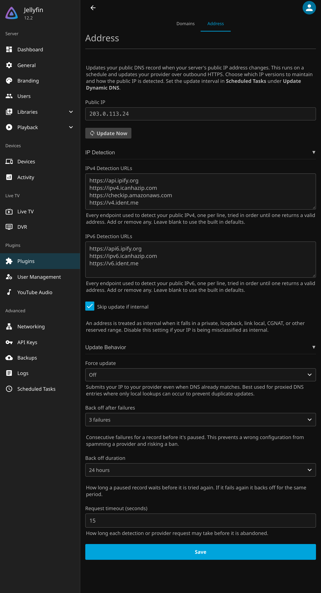

# Adding Records

## Adding a Record

Each record has a name, a provider, a hostname, and the credentials that provider needs. The `Domains` tab shows only the fields a provider actually uses to try and minimize confusion. Records live in the plugin configuration, so they are captured by your normal Jellyfin config backups. See [Providers](providers/README.md) for the fields each provider needs.

This is the editor for a Cloudflare record. Saved credentials show only as dots and are never sent back to the browser. Leaving a credential field blank keeps the saved value; use `Clear saved value` under the field to remove it.

Pick the provider from the `Provider` list, and the hint below it explains what each field means for that provider.

Providers in the dyndns family add an `Advanced Options` section with wildcard and MX settings.

If a record's hostname sits behind a proxy or CDN, turn on `Treat as Proxied Address`. The plugin then compares against the last IP it pushed rather than live DNS, since the DNS will return the proxied address. It's recommended to pair that with `Force Update` on the `Address` tab, which re-sends the record periodically in case it was changed from elsewhere.

## Address Families and Detection

Each record chooses its address families with `Update IPv4 (A)` and `Update IPv6 (AAAA)` on the `Domains` tab. Detection reads your public IP from endpoints that return it as plain text. The `IPv4 Detection URLs` and `IPv6 Detection URLs` fields list every endpoint, one per line. Only `https` endpoints are used, since a tampered reply could point your DNS at the wrong address. This process attempts to find two endpoints that agree on the address before submitting that IP. It falls back to only a single provider if there is only one active provider available.

The `Address` tab also shows the current public IP and an `Update Now` button that runs the task immediately. If detection finds only an internal address, which usually means the server has no public IP, the `Address` tab shows a warning so you know nothing was published. An address counts as internal when it falls in a private, loopback, link local, CGNAT, or other reserved range, and you can turn off `Skip Update if Internal` to publish such an address anyway.

Here is the `Address` tab with both sections expanded.

Next: [How Updates Run](HowItWorks.md).
