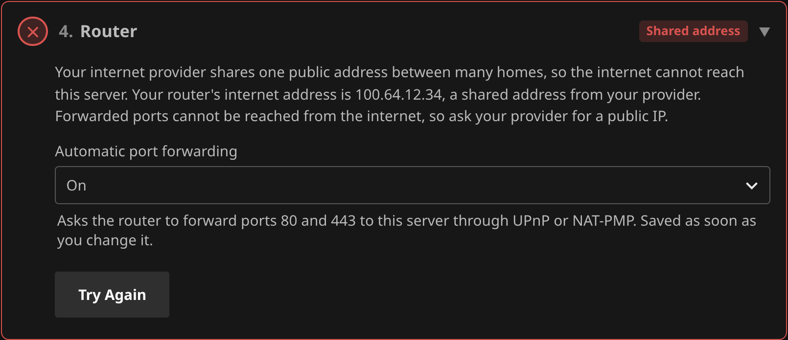

# Remote Access

Remote Access puts a secure HTTPS address in front of Jellyfin, such as `https://media.example.com`, from inside
the plugin. It gets the certificate for you, listens on the standard web ports, and turns away people trying to
break in. There is no separate reverse proxy to run.

For a complete walkthrough, see the Beginner's Guides: [free with Duck DNS](BeginnersGuideFree.md) or [recommended with your own domain](BeginnersGuide.md).

!!! warning "Everything runs inside Jellyfin"
    If Jellyfin is down, remote access is down too. See [Recovery](#recovery) for getting back in if a setting
    locks you out.

## Before you start

You need:

* **A domain name pointed at your home.** A [DDNS record](Records.md) keeps it pointed at your public IP.
* **A router that forwards ports**, on its own through UPnP or NAT-PMP or by hand, and a public IP of your own,
  not one shared through carrier-grade NAT. See [Shared addresses](#shared-addresses-and-cgnat).
* **On Linux**, permission for Jellyfin to use ports below 1024. Run `sudo systemctl edit jellyfin`, add
  `AmbientCapabilities=CAP_NET_BIND_SERVICE` under `[Service]`, and restart Jellyfin. Windows and macOS need
  nothing.
* **In Docker**, host networking. See [Docker, tunnels and other proxies](#docker-tunnels-and-other-proxies).

## Setup

Everything is on the **Configuration** tab, as six numbered steps. Each step shows its state, and the summary at
the top names the first step that needs attention.

1. **Proxy on**: tick **Enabled** and select **Save** at the bottom of the page.
2. **Address**: under **Proxy Address**, tick the names people will use. Names your DDNS records keep pointed at
   this server are listed for you. Add any others under **Other addresses**. The step then checks that the name
   points at this server. See [Name check](#name-check).
3. **Certificate**: leave **Let's Encrypt** selected, tick **I accept the Let's Encrypt terms**, and save. See
   [Certificates](#certificates).
4. **Router**: with **Automatic port forwarding** on, the plugin asks the router to forward the ports. If the
   router does not, forward TCP ports **80** and **443** by hand to the address this step shows. See
   [Automatic port forwarding](#automatic-port-forwarding).
5. **Trust the Proxy**: select **Trust the Proxy**. Until then, internet visitors are turned away. Jellyfin
   restarts once so it can see each visitor's real address through the proxy. Its own ports stay the same.
   **Undo** puts its settings back.
6. **Reachable from outside**: select **Test from Outside**. See [Test from Outside](#test-from-outside).

When every step is done, the summary says the server is fully accessible from outside your network. Then open your
address on a phone with Wi-Fi turned off.

### Ports

| Port | Used for |
|---|---|
| 443 | HTTPS for everyone outside your home. The router forwards it, or you do. |
| 80 | Sends `http://` links on to HTTPS, and lets Let's Encrypt check your address. Forwarded the same way. |
| Jellyfin's own | Usually 8096 and 8920. Unchanged, and your home network keeps using them. |

Do not forward Jellyfin's own ports. Internet traffic should only reach the proxy. If this server has a public
address of its own, such as a VPS or a public IPv6 address, block Jellyfin's ports in its firewall too. Step 5 of
the Configuration tab warns when it finds one. To close that gap from the plugin instead, see
[Only through the proxy](#only-through-the-proxy).

## Name check

Step 2 looks up the first public name under **Proxy Address** and compares it with this server's public IP.

* **Ready**: the name points to this server.
* **Not pointed here**: the name does not point anywhere yet, or points somewhere else. A new record can take a few
  minutes to appear. Otherwise check its DDNS record. The step lists where the name points and this server's
  public IP.
* **Not found**: the name could not be looked up.
* **Home only**: every name ends in a home network ending, such as `.local`, `.lan` or `.home.arpa`, so it only
  works at home. Choose a public name.

A name behind Cloudflare's orange cloud points at Cloudflare, so it shows as **Not pointed here**.

## Automatic port forwarding

**Automatic port forwarding**, in step 4 of the Configuration tab, asks your router to forward the ports for you.
It is on by default, and is saved as soon as you change it.

* The plugin asks the router through NAT-PMP first, then UPnP. Most home routers support one of them, though some
  ship with it turned off.
* Port 80 is forwarded while the proxy runs. Port 443 follows once a certificate lets the proxy answer HTTPS.
* Each forward points at this server's address on your network, the one step 4 shows.
* The router keeps a forward for 2 hours, and the plugin renews it every hour.
* The forwards are removed when Jellyfin shuts down, when the proxy or this setting is turned off, and when the
  plugin is uninstalled.
* A port the router already forwards to another device is left alone. Step 4 says which port is taken. Remove that
  rule on the router, or forward by hand.
* It only covers IPv4. For visitors over IPv6, allow ports 80 and 443 to this server in the router's firewall.
* **Try Again** asks the router once more straight away.
* Each change is written to the activity log. See [Monitoring](Monitoring.md#remote-access-entries).

When the router does not open the ports, or the setting is off, step 4 shows **Forward by hand** with the rule to
add: TCP ports **80** and **443** to the address it shows. The server cannot see ports forwarded by hand, so step 4
turns green once **Test from Outside** reaches the server.

### Shared addresses and CGNAT

Some internet providers share one public address between many homes, called carrier-grade NAT or CGNAT. Behind it,
no forwarded port can be reached from the internet. Step 4 compares the internet address the router reports with
the public IP the internet sees, and shows **Shared address** when:

* the router's internet address is in `100.64.0.0/10`, the range providers use for shared addresses,
* the router's internet address is a private one, such as `192.168.0.1`, so another router or your provider stands
  between it and the internet. Forward the ports on that one too, or set it to bridge mode,
* the router's internet address differs from the public IP, so your provider likely shares one address between
  customers, or this server reaches the internet through a VPN.

Ask your provider for a public IP. Many give one for free or a small monthly fee. The check needs a router that
answers over UPnP or NAT-PMP. Without one, compare the addresses yourself as in
[Check you are not behind CGNAT](BeginnersGuide.md#0-check-you-are-not-behind-cgnat).

## Test from Outside

Step 6, **Reachable from outside**, checks your address the way a visitor would. **Test from Outside** asks
[check-host.net](https://check-host.net) to connect to your public name on port 443 from up to three places around
the world. It can take 20 seconds.

* **Reachable**: at least one place connected. Each place is listed with its result.
* **Not reachable**: no place could connect. Check step 4, and ask your provider whether it blocks port 443.
* **Test failed**: check-host.net could not be reached or was busy. Try again in a minute.

The test needs a public name under **Proxy Address**. A connection counts even when the country rule closes it at
once, since the test is about the port.

!!! note "What is sent"
    Only the hostname and the port are sent to check-host.net, and only when you select **Test from Outside**.

## Certificates

| Source | When to use it |
|---|---|
| **Let's Encrypt** | The default. Free, and renewed for you. |
| **PEM files** | You already run certbot, acme.sh or similar. Renewals are picked up within a minute. |
| **PKCS#12 file** | You have a single `.pfx` or `.p12` file. |
| **Self-signed** | No outside service at all. Each device has to trust it once, and TVs cannot. |

Let's Encrypt is only contacted once **I accept the Let's Encrypt terms** is ticked. The terms are the
[Let's Encrypt Subscriber Agreement](https://letsencrypt.org/repository/).

### How Let's Encrypt checks your address

Let's Encrypt only issues a certificate after checking that the address really points at you. The plugin picks the
check, and the Certificate step says which is in use:

* **Through DNS**, when every address is covered by a **Cloudflare** or **Duck DNS** DDNS record.
  The plugin publishes a short-lived TXT record with that provider. Port 80 is not needed, and wildcard addresses
  such as `*.example.com` work. A Cloudflare token needs the **Edit zone DNS** permission.
* **Through port 80** otherwise. Let's Encrypt fetches a file from `http://your-address/`, so port 80 must be
  forwarded. Wildcard addresses are left off the certificate.

### Renewal

Certificates last 90 days. The **Refresh Certificate** scheduled task checks daily, and saving the
Configuration tab checks too. Either one requests a new certificate when there is none, when it no longer covers your addresses, or
within 30 days of expiry. A new certificate is used straight away.

If Let's Encrypt refuses, the reason shows in step 3, **Certificate**, and in the activity log. The next try waits an hour,
doubling up to a day, to stay within Let's Encrypt's limits. Changing the address tries again at once.

To replace a certificate now, for example if its key may have leaked, select **Request a New Certificate** in the
Certificate step. Let's Encrypt allows five copies of the same certificate a week.

!!! tip "Testing first"
    Set the environment variable `DDNS_ACME_DIRECTORY` to
    `https://acme-staging-v02.api.letsencrypt.org/directory` to use Let's Encrypt's test server. Its certificates
    are not trusted, but they do not count against the real limits.

### Self-signed certificates

The plugin makes its own root certificate once, valid for ten years, and issues the proxy's certificate from it.
That certificate renews itself about every 13 months, and whenever your addresses change. A device that trusts
the root trusts every renewal, so you only install the root once per device.

1. In the Certificate step, select **Download Root Certificate**. It saves `remote-access-root.crt`, which
   holds no private key.
2. Install it on each device as below. Before trusting it, check that the device shows the same SHA-256
   fingerprint as the Certificate step.

| Device | How to install |
|---|---|
| Windows | Open the file, select **Install Certificate**, choose **Place all certificates in the following store**, and pick **Trusted Root Certification Authorities**. Edge and Chrome use this store. |
| macOS | Open the file to add it to Keychain Access, open it there, and set **When using this certificate** to **Always Trust**. |
| iPhone and iPad | Send it to the device and open it, install it under **Settings → Profile Downloaded**, then turn it on under **Settings → General → About → Certificate Trust Settings**. |
| Android | Install it under **Settings → Security → Encryption & credentials → Install a certificate → CA certificate**. Browsers trust it, but most apps ignore certificates you install, so check the Jellyfin app. |
| Firefox | Firefox can keep its own list: **Settings → Privacy & Security → Certificates → View Certificates → Authorities → Import**. |
| TVs and streaming boxes | Roku, Fire TV, Android TV and most smart TVs cannot install a certificate, so their Jellyfin apps refuse the connection. Use Let's Encrypt for them. |

The root is only replaced if its file is lost or damaged, or within a year of its end. The activity log says when
that happens, and every device then needs the new root.

## Protection

These are on by default, and each can be changed under **Advanced**.

* **Your own network is never blocked.** Bans, the block list and country rules only apply to the internet.
* **Country rule**: only visitors from the country this server is in can connect. Add countries in the
  **Countries** picker under **Advanced → Blocking**, or set **Country rule** to **Off**. Unblocking a country from
  the Dashboard adds it. The rule blocks you abroad too, so see
  [Travelling abroad](BeginnersGuide.md#after-setup) before a trip.
* **Bans**: 5 failed sign-ins within 10 minutes bans the address for 60 minutes. An IPv6 visitor is banned with
  its whole /64, since it can pick any address in it. Failures spread over many /64s ban the wider /56 after 3 times
  **Failed sign-ins before a ban**, or the /48 after 6 times, which is 15 and 30 at the default. Those wider bans last at most 15 minutes, since they shut out others in that network too.
* **Sign-in limits**: an address can have two sign-ins in progress at once, a /56 four and a /48 eight, and each
  must arrive within 10 seconds.
* **Immediate**: a ban, a block or a new country rule also closes connections already open, streams included.
* **Setup wizard**: never reachable from the internet.
* **Unknown names**: requests for any name you did not add, your bare IP included, are dropped before anything
  is encrypted.
* **HTTPS only**: browsers are told to always use HTTPS for your addresses, and TLS 1.2 or 1.3 is required.

### Low-memory servers

When less than 3 GB of memory is available to Jellyfin, such as on a single-board computer or in a container with
a memory limit, the proxy holds fewer connections: 500 in total instead of 2000, 32 per internet address instead
of 64, and idle connections close after 60 seconds instead of 130. .NET counts three quarters of a container's
limit, so a 4 GB container counts as 3 GB and gets the standard values, while a 2 GB container counts as 1.5 GB
and gets the lower ones. This only changes settings you have not set yourself. **Advanced**
shows both defaults and which one applies.

## Dashboard

The **Dashboard** tab shows who connects, where from, and what was turned away, with bans you can lift and
addresses you can block. See [Dashboard](Dashboard.md).

## Other apps

The proxy serves Jellyfin only. To reach other apps on your network from outside, such as a request manager, use a
general reverse proxy instead, for example [NGINX](https://nginx.org), [Apache](https://httpd.apache.org) or
[SWAG](https://docs.linuxserver.io/general/swag), which bundles NGINX with Let's Encrypt. Give it ports 80 and 443,
turn Remote Access off, and point it at Jellyfin as Jellyfin's
[networking guide](https://jellyfin.org/docs/general/post-install/networking/) describes. The plugin's Dynamic DNS
keeps working alongside it.

## Only through the proxy

**Advanced → Security → Only through the proxy** makes the proxy the only way into Jellyfin. While Jellyfin
trusts the proxy, it listens on this server alone, so even a port left forwarded on the router, or a public
address on the server, cannot reach it directly.

It is off by default, because it changes how things at home connect:

| Normally | With it on |
|---|---|
| Apps at home connect to `http://192.168.1.10:8096` | Apps at home connect by your address, such as `https://media.example.com`. Jellyfin tells them to. |
| Your address may only work from outside | Your address has to work at home too, through your router or a local DNS entry |
| Apps can find Jellyfin by searching the network | Searching finds nothing, so add the server by its address |
| Chromecast and similar devices fetch from the server's local address | They go through the proxy too, so your address has to work for them at home |
| DLNA devices see Jellyfin | DLNA stops working |

Visitors at home still count as local, so bans, the block list and country rules never apply to them.

It needs at least one address that is not a wildcard. Turning it on or off while Jellyfin trusts the proxy
restarts Jellyfin once, and a change that cannot be applied is refused rather than saved.

If the proxy fails to start while this is on, nothing could reach Jellyfin. The plugin then puts Jellyfin's own
addresses back by itself, and Jellyfin's activity log says why, such as a port in use.

## Docker, tunnels and other proxies

The proxy needs to see each visitor's real address. Some setups hide it, because something in front of the proxy
makes the connections itself:

* rootless Docker or rootless Podman,
* Docker's IPv6 handling when ip6tables is off,
* a tunnel such as Cloudflare Tunnel, or another reverse proxy in front of this one.

In Docker, use host networking (`network_mode: host`). Do not also publish Jellyfin's own port with
`-p 8096:8096`, since Docker opens published ports past firewalls such as ufw.

### When every visitor looks local

When something hides the real addresses, every visitor seems to come from the same local address. The proxy then
treats everyone as part of your home network, strangers included:

* bans, the block list and country rules never apply,
* the Dashboard shows only local visitors, with no countries.

The only fix is to let the real addresses reach the proxy, for example with host networking. There is no setting
that works around it. The Configuration tab warns, and the activity log notes it once, when an hour brings 100 or more
requests for your public names, all from one local address and none from the internet.

## Recovery

* **Undo** in step 5 of the Configuration tab puts Jellyfin's network settings back as they were before **Trust the Proxy**.
* **Locked out of the dashboard?** Create an empty file named `DISABLE` in
  `plugins/configurations/Jellyfin.Plugin.DynamicDns.Proxy/` under Jellyfin's data folder, and restart
  Jellyfin. The proxy stays off and Jellyfin's network settings go back as they were. Putting them back may
  restart Jellyfin a second time. Delete the file to turn the proxy on again.
* **Files the plugin cannot open?** Jellyfin is running as a different account than the one that made them. Run
  the command the Configuration tab shows, then restart Jellyfin.
* **Uninstalling** puts Jellyfin's network settings back first, and removes the forwards the plugin opened on the
  router.

!!! warning "Disabling the plugin"
    Disabling the plugin on Jellyfin's Plugins page stops the proxy but leaves Jellyfin trusting it. With
    **Only through the proxy** on, nobody can reach Jellyfin at all. Use **Undo** before disabling. If you are
    already locked out, create the `DISABLE` file and restart with the plugin enabled, or stop Jellyfin and copy
    `network.before-remote-access.xml` over `network.xml` in Jellyfin's config folder.
