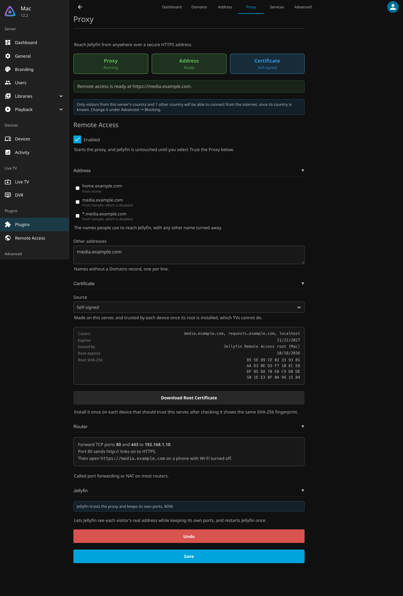
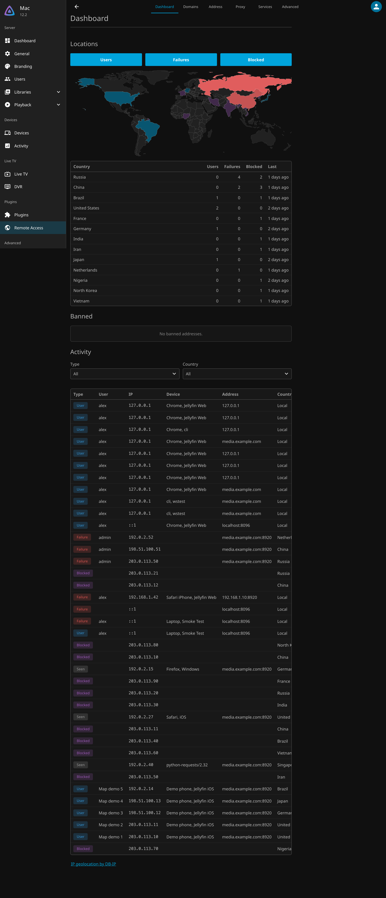
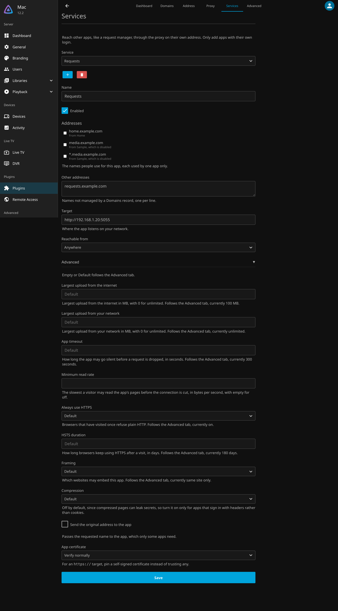

# Remote Access

Remote Access puts a secure HTTPS address in front of Jellyfin, such as `https://media.example.com`, from inside
the plugin. It gets the certificate for you, listens on the standard web ports, and turns away people trying to
break in. There is no separate reverse proxy to run.

For a complete walkthrough with a new domain, see [the Beginner's Guide](BeginnersGuide.md).

!!! warning "Everything runs inside Jellyfin"
    If Jellyfin is down, remote access is down too. See [Recovery](#recovery) for getting back in if a setting
    locks you out.

## Before you start

You need:

* **A domain name pointed at your home.** A [Domains record](Records.md) keeps it pointed at your public IP.
* **A router you can forward ports on**, and a public IP of your own. Compare the internet or WAN address your
  router shows with the **Public IP** on the **Address** tab. If they differ, or the router's starts with
  `100.64` to `100.127`, your internet provider shares one address between many homes. This is called
  carrier-grade NAT, and forwarded ports cannot be reached. Ask your provider for a public IP.
* **On Linux**, permission for Jellyfin to use ports below 1024. Run `sudo systemctl edit jellyfin`, add
  `AmbientCapabilities=CAP_NET_BIND_SERVICE` under `[Service]`, and restart Jellyfin. Windows and macOS need
  nothing.
* **In Docker**, host networking. See [Docker, tunnels and other proxies](#docker-tunnels-and-other-proxies).

## Setup

Everything is on the **Proxy** tab. The cards at the top show what is left to do, and each section is one step.

1. **Remote Access**: tick **Enabled** and save.
2. **Address**: tick the names people will use. Names your Domains records keep pointed at this server are listed
   for you. Add any others under **Other addresses**.
3. **Certificate**: leave **Let's Encrypt** selected, tick **I accept the Let's Encrypt terms**, and save. See
   [Certificates](#certificates).
4. **Router**: forward TCP ports **80** and **443** on your router to the address this section shows.
5. **Jellyfin**: select **Trust the Proxy**. Jellyfin restarts once so it can see each visitor's real address
   through the proxy. Its own ports stay the same. **Undo** puts its settings back.

Then open your address on a phone with Wi-Fi turned off. The summary at the top of the tab says when everything is
ready.

### Ports

| Port | Used for |
|---|---|
| 443 | HTTPS for everyone outside your home. Forward it. |
| 80 | Sends `http://` links on to HTTPS, and lets Let's Encrypt check your address. Forward it too. |
| Jellyfin's own | Usually 8096 and 8920. Unchanged, and your home network keeps using them. |

Do not forward Jellyfin's own ports. Internet traffic should only reach the proxy. If this server has a public
address of its own, such as a VPS or a public IPv6 address, block Jellyfin's ports in its firewall too. The Proxy
tab warns when it finds one. To close that gap from the plugin instead, see
[Only through the proxy](#only-through-the-proxy).

## Certificates

| Source | When to use it |
|---|---|
| **Let's Encrypt** | The default. Free, and renewed for you. |
| **PEM files** | You already run certbot, acme.sh or similar. Renewals are picked up within a minute. |
| **PKCS#12 file** | You have a single `.pfx` or `.p12` file. |
| **Self-signed** | No outside service at all. Each device has to trust it once, and TVs cannot. |

Let's Encrypt is only contacted once **I accept the Let's Encrypt terms** is ticked. The terms are the
[Let's Encrypt Subscriber Agreement](https://letsencrypt.org/repository/).

### How Let's Encrypt checks your address

Let's Encrypt only issues a certificate after checking that the address really points at you. The plugin picks the
check, and the Certificate section says which is in use:

* **Through DNS**, when every address is covered by a **Cloudflare** or **Duck DNS** record on the Domains tab.
  The plugin publishes a short-lived TXT record with that provider. Port 80 is not needed, and wildcard addresses
  such as `*.example.com` work. A Cloudflare token needs the **Edit zone DNS** permission.
* **Through port 80** otherwise. Let's Encrypt fetches a file from `http://your-address/`, so port 80 must be
  forwarded. Wildcard addresses are left off the certificate.

### Renewal

Certificates last 90 days and renew automatically within 30 days of expiry. The **Refresh Certificate**
scheduled task checks daily, and saving the Proxy tab checks too. A new certificate is used straight away.

If Let's Encrypt refuses, the reason shows on the Proxy tab and in the activity log. The next try waits an hour,
doubling up to a day, to stay within Let's Encrypt's limits. Changing the address tries again at once.

To replace a certificate now, for example if its key may have leaked, select **Request a New Certificate** in the
Certificate section. Let's Encrypt allows five copies of the same certificate a week.

!!! tip "Testing first"
    Set the environment variable `DDNS_ACME_DIRECTORY` to
    `https://acme-staging-v02.api.letsencrypt.org/directory` to use Let's Encrypt's test server. Its certificates
    are not trusted, but they do not count against the real limits.

### Self-signed certificates

The plugin makes its own root certificate once, valid for ten years, and issues the proxy's certificate from it.
That certificate renews itself about every 13 months, and whenever your addresses change. A device that trusts
the root trusts every renewal, so you only install the root once per device.

1. In the Certificate section, select **Download Root Certificate**. It saves `remote-access-root.crt`, which
   holds no private key.
2. Install it on each device as below. Before trusting it, check that the device shows the same SHA-256
   fingerprint as the Proxy tab.

| Device | How to install |
|---|---|
| Windows | Open the file, select **Install Certificate**, choose **Place all certificates in the following store**, and pick **Trusted Root Certification Authorities**. Edge and Chrome use this store. |
| macOS | Open the file to add it to Keychain Access, open it there, and set **When using this certificate** to **Always Trust**. |
| iPhone and iPad | Send it to the device and open it, install it under **Settings → Profile Downloaded**, then turn it on under **Settings → General → About → Certificate Trust Settings**. |
| Android | Install it under **Settings → Security → Encryption & credentials → Install a certificate → CA certificate**. Browsers trust it, but most apps ignore certificates you install, so check the Jellyfin app. |
| Firefox | Firefox can keep its own list: **Settings → Privacy & Security → Certificates → View Certificates → Authorities → Import**. |
| TVs and streaming boxes | Roku, Fire TV, Android TV and most smart TVs cannot install a certificate, so their Jellyfin apps refuse the connection. Use Let's Encrypt for them. |

The root is only replaced if its file is lost or damaged, or within a year of its end. The activity log says when
that happens, and every device then needs the new root.

## Protection

These are on by default, and each can be changed under **Advanced**.

* **Your own network is never blocked.** Bans, the block list and country rules only apply to the internet.
* **Country rule**: only visitors from the country this server is in can connect. Add countries, or turn it off,
  under **Advanced → Blocking**. Unblocking a country from the Dashboard adds it.
* **Bans**: 5 failed sign-ins within 10 minutes bans the address for 60 minutes. An IPv6 visitor is banned with
  its whole /64, since it can pick any address in it. Failures spread over many /64s ban the wider /56 after 15,
  or /48 after 30. Those wider bans last at most 15 minutes, since they shut out others in that network too.
* **Sign-in limits**: an address can have two sign-ins in progress at once, a /56 four and a /48 eight, and each
  must arrive within 10 seconds.
* **Immediate**: a ban, a block or a new country rule also closes connections already open, streams included.
* **Setup wizard**: never reachable from the internet.
* **Unknown names**: requests for any name you did not add, your bare IP included, are dropped before anything
  is encrypted.
* **HTTPS only**: browsers are told to always use HTTPS for your addresses, and TLS 1.2 or 1.3 is required.

!!! tip "Travelling"
    The country rule also blocks you when you are abroad. Add the country you are visiting under
    **Advanced → Blocking** before you go.

### Low-memory servers

When less than 3 GB of memory is available to Jellyfin, such as on a single-board computer or in a container with
a memory limit, the proxy holds fewer connections: 500 in total instead of 2000, 32 per internet address instead
of 64, and idle connections close after 60 seconds instead of 130. .NET counts three quarters of a container's
limit, so a 4 GB container counts as 3 GB. This only changes settings you have not set yourself. **Advanced**
shows both defaults and which one applies.

## Dashboard

The **Dashboard** tab shows who connects:

* **Locations**: a world map and table by country, of users, failed sign-ins and blocked visitors.
* **Banned**: addresses banned for failed sign-ins, each with **Unban**.
* **Activity**: every address and what it did. **User** signed in, **Failure** failed to, **Blocked** was turned
  away, and **Seen** reached the sign-in page and did nothing else. Each row can be blocked or unblocked.

Locations come from the free DB-IP database, downloaded to this server, so addresses are never sent anywhere. What
is recorded, and for how long, is under **Advanced → History**.

## Services

The **Services** tab puts other apps on your network, such as a request manager, behind the same proxy on their own
address, such as `requests.example.com`. Only add apps that have their own sign-in.

Let's Encrypt adds each Service's address to the certificate. Services set to your network only, and names that
only your own DNS knows, such as `nas.lan`, are left off, since Let's Encrypt can never check them.

## Only through the proxy

**Advanced → Security → Only through the proxy** makes the proxy the only way into Jellyfin. While Jellyfin
trusts the proxy, it listens on this server alone, so even a port left forwarded on the router, or a public
address on the server, cannot reach it directly.

It is off by default, because it changes how things at home connect:

| Normally | With it on |
|---|---|
| Apps at home connect to `http://192.168.1.10:8096` | Apps at home connect by your address, such as `https://media.example.com`. Jellyfin tells them to. |
| Your address may only work from outside | Your address has to work at home too, through your router or a local DNS entry |
| Apps can find Jellyfin by searching the network | Searching finds nothing, so add the server by its address |
| Chromecast and similar devices fetch from the server's local address | They go through the proxy too, so your address has to work for them at home |
| DLNA devices see Jellyfin | DLNA stops working |

Visitors at home still count as local, so bans, the block list and country rules never apply to them.

It needs at least one address that is not a wildcard. Turning it on or off while Jellyfin trusts the proxy
restarts Jellyfin once, and a change that cannot be applied is refused rather than saved.

## Docker, tunnels and other proxies

The proxy needs to see each visitor's real address. Some setups hide it, because something in front of the proxy
makes the connections itself:

* rootless Docker or rootless Podman,
* Docker's IPv6 handling when ip6tables is off,
* a tunnel such as Cloudflare Tunnel, or another reverse proxy in front of this one.

In Docker, use host networking (`network_mode: host`). Do not also publish Jellyfin's own port with
`-p 8096:8096`, since Docker opens published ports past firewalls such as ufw.

### When every visitor looks local

When something hides the real addresses, every visitor seems to come from the same local address. The proxy then
treats everyone as part of your home network, strangers included:

* bans, the block list and country rules never apply,
* the Dashboard shows only local visitors, with no countries.

The only fix is to let the real addresses reach the proxy, for example with host networking. There is no setting
that works around it. The Proxy tab warns, and the activity log notes it once, when an hour brings 100 or more
requests for your public names, all from one local address and none from the internet.

## Recovery

* **Undo** on the Proxy tab puts Jellyfin's network settings back as they were before **Trust the Proxy**.
* **Locked out of the dashboard?** Create an empty file named `DISABLE` in
  `plugins/configurations/Jellyfin.Plugin.DynamicDns.Proxy/` under Jellyfin's data folder, and restart
  Jellyfin. The proxy stays off and Jellyfin's network settings go back as they were. Delete the file to turn
  the proxy on again.
* **Files the plugin cannot open?** Jellyfin is running as a different account than the one that made them. Run
  the command the Proxy tab shows, then restart Jellyfin.
* **Uninstalling** puts Jellyfin's network settings back first.

!!! warning "Disabling the plugin"
    Disabling the plugin on Jellyfin's Plugins page stops the proxy but leaves Jellyfin trusting it. With
    **Only through the proxy** on, nobody can reach Jellyfin at all. Use **Undo** before disabling. If you are
    already locked out, create the `DISABLE` file and restart with the plugin enabled, or stop Jellyfin and copy
    `network.before-remote-access.xml` over `network.xml` in Jellyfin's config folder.
