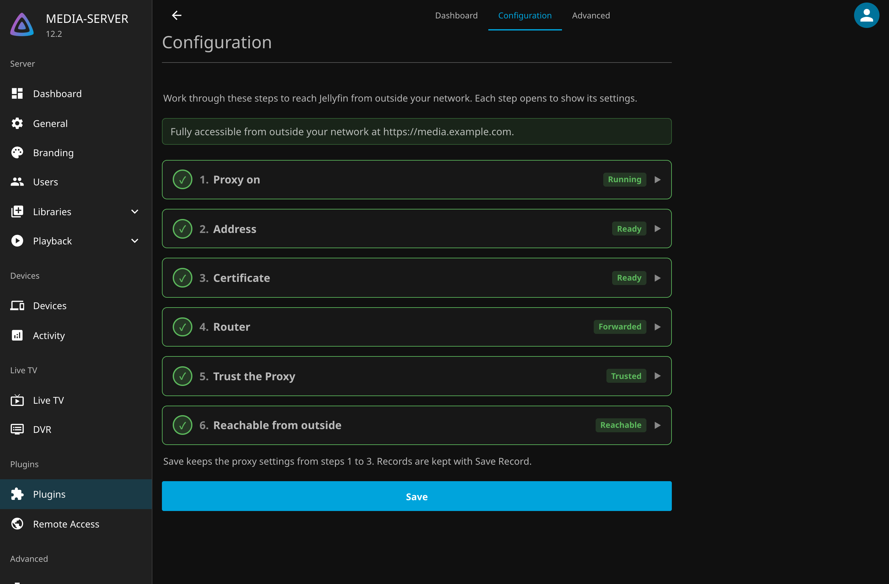

# Remote Access

{ width="160" }

Remote Access is a Jellyfin plugin for reaching your server from anywhere. It does two things, both inside
Jellyfin:

* **Dynamic DNS** keeps a domain name, such as `media.example.com`, pointed at your home's public IP, even when
  your internet provider changes it. It supports [45 DNS providers](providers/README.md).
* **The proxy** puts a secure HTTPS address in front of Jellyfin, with a free certificate from Let's Encrypt and
  protection against people trying to break in. See [Remote Access](RemoteAccess.md).

You can use Dynamic DNS on its own, or both together. There is no separate reverse proxy or updater to run.

!!! danger "Actively being tested"
    The proxy, certificates and blocking are new and still changing between releases. Keep another way into your
    server while you try them, and report anything that looks wrong in
    [Issues](https://github.com/JPKribs/jellyfin-plugin-remoteaccess/issues).

!!! warning "Everything depends on Jellyfin"
    If Jellyfin is down, so are your DNS updates and your remote access. If you rely on this address to manage the
    server itself, keep another way in as well.

## Where to start

* **New to all of this?** Follow a Beginner's Guide. Each goes from nothing to watching from your phone, in one
  pass. The [free guide](BeginnersGuideFree.md) uses a free Duck DNS name. The
  [recommended guide](BeginnersGuide.md) uses a domain of your own from Cloudflare, about $10 a year.
* **Already have a domain?** [Install the plugin](Installation.md), [add a record](Records.md), then set up
  [Remote Access](RemoteAccess.md).
* **Want a tour first?** [The Plugin's Pages](Pages.md) shows every tab.

The DNS providers are ported from [ddclient](https://github.com/ddclient/ddclient), which is the recommended tool
if you want Dynamic DNS outside Jellyfin.
